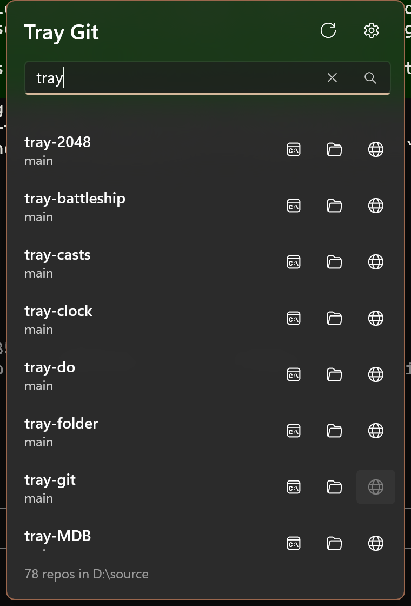

# Tray Git



Every git repo in your source folder, one click from the taskbar: open a terminal in it, open it in File Explorer, or open its remote in the browser.

Tray Git is a WinUI 3 app that lives in the Windows notification area. It has no main window: the tray icon opens a small, always-on-top flyout next to the icon with a filterable list of your repos.

## Features

- **Source folder:** pick the folder that holds your repos (for example `D:\source`). Tray Git finds every working copy up to four folders deep. It stops at each repo, so submodules and vendored checkouts don't clutter the list, and it skips `node_modules`, `bin`, `obj`, dot-folders and similar trees.
- **Three one-click actions per repo:**
  - **Terminal** opens Windows Terminal in the repo (`wt -d`), following your Terminal settings for new tab vs. new window. Without Windows Terminal it falls back to PowerShell 7, then Windows PowerShell.
  - **Folder** opens the repo in File Explorer. Double-clicking a row does the same.
  - **Remote** opens the `origin` remote (or the first remote) in your browser. GitHub, GitLab, Bitbucket, Azure DevOps and self-hosted servers work, whether the remote is https, ssh (`git@host:owner/repo.git`) or `git://`. Credentials and ssh ports are stripped. The button is disabled for repos with no remote or a local-path remote.
- **Filter:** start typing as soon as the flyout opens. Every word must match the repo name or its path under the source folder. Press **Enter** to open a terminal in the top match.
- **Recent first:** repos you've used through Tray Git sort to the top. Otherwise the list is alphabetical.
- **Branch at a glance:** each row shows the checked-out branch (or short commit when detached), then its status, then the parent folder. Status is lines added in green and removed in red (working tree and index versus `HEAD`), `↓n` commits to pull and `↑n` commits to push.
- **Fetch:** right-click a row, or swipe it left on a touch screen or pen, and choose **Fetch** to run `git fetch` and refresh that row's status. A spinner shows while it runs, and errors appear in the flyout.
- **Favorites:** right-click a row, or swipe it left, and choose **Favorite** (or **Unfavorite**). Favorites get a star next to the name. The star button in the header narrows the list to favorites only; it stays on until you turn it off, and the filter box still applies within it.
- **Worktrees:** `git worktree` checkouts are listed as their own entries, with the remote read from the main repo.
- **Light dismiss:** the flyout hides when it loses focus or when you press Escape, and clicking the tray icon toggles it.
- **Tray menu:** right-click the icon for Open, Settings and Exit.
- **Settings:** a page inside the flyout (gear button or the tray menu) with the source folder and Start with Windows. Escape, Alt+Left or the mouse back button returns to the list.
- **Theme-aware tray icon:** a dark glyph on a light taskbar, a white glyph on a dark one, switching live with the Windows theme.
- **Single instance:** launching the app again opens the running instance's flyout.

## Install

**[Install Tray Git](https://github.com/Tray-Land/tray-git/releases/latest/download/TrayGit.appinstaller)** (opens the `.appinstaller` with Windows App Installer).

Windows picks the right build for your PC (x64 or ARM64), installs the Windows App Runtime if it is missing, and keeps Tray Git up to date from the newest stable release: it checks when the app starts and in the background, and downloads only the parts of the package that changed. Release packages are signed with a self-signed certificate; install the `.cer` from the release into **Local Machine > Trusted People** first.

You can also download `TrayGit_<version>.msixbundle` from the [releases](../../releases) page. It contains both architectures and also updates itself, but it does not install the Windows App Runtime for you.

Requirements: Windows 10 1809 (build 17763) or later, or Windows 11, on x64 or ARM64. [Windows Terminal](https://aka.ms/terminal) is recommended but not required. [Git](https://git-scm.com/download/win) must be on the PATH for the status segment and Fetch; without it the list still works, just without status.

## Setup

On first run the flyout opens with **Choose source folder**. Pick your folder and the list appears. Change it any time from the gear button. There are no accounts or keys.

## Privacy and footprint

- Tray Git makes **no network calls of its own**. The only things that leave your machine are the browser you open with the Remote button and the `git fetch` you start with Fetch, which uses your normal git remotes and credentials.
- The list and scan read only each repo's `.git/HEAD` and `.git/config`. While the flyout is open, the status segment runs read-only `git diff HEAD --numstat` and `git status` in each repo (no locks taken, no files changed), at most every 30 seconds per repo.
- The scan runs only while the flyout is open: when it opens and the last scan is over five minutes old, when you change the source folder, or when you press Rescan. Results are cached in the app's local folder (`repos.json`) so the list appears instantly.
- Settings (the source folder, recent-use times, favorites and the favorites-only toggle) are stored in the app's local settings. Nothing is stored outside the app's package data.
- When hidden for a minute, the flyout closes and returns its memory to Windows.

## Build from source

Prerequisites: the [.NET 10 SDK](https://dotnet.microsoft.com/download), the winapp CLI (`winget install Microsoft.WinAppCli`), and Developer Mode turned on (Settings > System > For developers).

```powershell
winapp run              # build, register with package identity, and launch
winapp run --clean      # same, starting from first-run state
dotnet test tests\TrayGit.Tests
```

Look in the taskbar overflow (^) if the tray icon is hidden.

Releases are built with `build-msix-for-gh.ps1`, which builds x64 and ARM64 packages, bundles them into one signed `.msixbundle`, writes the `.appinstaller` feed, checks the bundle, and creates a draft GitHub release. The feed's `latest/download` link starts working when you publish the draft as the latest (non-pre-release) release.

## Project layout

| Path | What it holds |
|---|---|
| `App.xaml.cs` | Tray icon, context menu, single instance, the only exit path |
| `Views/TrayFlyoutWindow` | Borderless popup: placement, light dismiss, animation, idle close, page swap, and the folder picker (light dismiss pauses while it is open) |
| `Views/FlyoutPage` | The repo list, filter, and actions |
| `Views/SettingsPage` | Settings page shown in the flyout: source folder, Start with Windows, version |
| `Core/` | Platform-free logic: `RepoScanner`, `GitMetadata` (`.git` parsing), `RemoteUrlPolicy` (remote → web URL), `RepoListPolicy` (filter and order), `RepoStatus` (git output parsing) |
| `Services/RepoStore`, `Services/RepoLauncher`, `Services/GitService` | Scan cache, the terminal / folder / remote launchers, and the git status and fetch runner |
| `tests/TrayGit.Tests` | MSTest project that links `Core/` |

## License

MIT, see [LICENSE](LICENSE).
